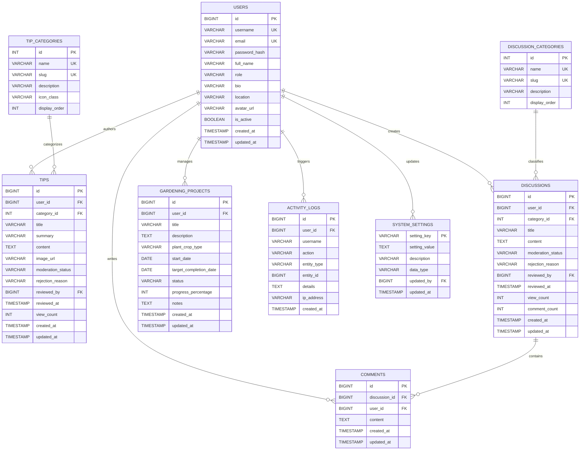

# GardenConnect - Database Schema Specification

## 1. Entity-Relationship (ER) Diagram



---

## 2. Table Data Dictionary

### 2.1 Table: `users`
Stores authenticated user accounts for both gardeners and administrators.

| Column | Type | Constraints | Description |
|---|---|---|---|
| `id` | `BIGINT` | `PK, AUTO_INCREMENT` | Unique identifier for the user account |
| `username` | `VARCHAR(50)` | `NOT NULL, UNIQUE` | Unique login username (alphanumeric + underscore) |
| `email` | `VARCHAR(150)` | `NOT NULL, UNIQUE` | Unique email address for notifications and login |
| `password_hash` | `VARCHAR(255)` | `NOT NULL` | Cryptographic BCrypt salted password hash |
| `full_name` | `VARCHAR(100)` | `NOT NULL` | Display name of the community member |
| `role` | `VARCHAR(20)` | `NOT NULL, DEFAULT 'GARDENER'` | RBAC role: `GARDENER` or `ADMIN` |
| `bio` | `TEXT` | `NULL` | Personal gardening background summary |
| `location` | `VARCHAR(100)` | `NULL` | Geographic hardiness zone or city |
| `avatar_url` | `VARCHAR(255)` | `NULL` | Profile avatar image path or URL |
| `is_active` | `BOOLEAN` | `NOT NULL, DEFAULT TRUE` | Active/suspended account flag |
| `created_at` | `TIMESTAMP` | `DEFAULT CURRENT_TIMESTAMP` | Account creation timestamp |
| `updated_at` | `TIMESTAMP` | `DEFAULT CURRENT_TIMESTAMP ON UPDATE CURRENT_TIMESTAMP` | Last profile update timestamp |

### 2.2 Table: `tip_categories`
Taxonomy for gardening advice and community guides.

| Column | Type | Constraints | Description |
|---|---|---|---|
| `id` | `INT` | `PK, AUTO_INCREMENT` | Unique category identifier |
| `name` | `VARCHAR(50)` | `NOT NULL, UNIQUE` | Display name (e.g., Vegetables, Pest Control) |
| `slug` | `VARCHAR(60)` | `NOT NULL, UNIQUE` | URL-friendly slug identifier |
| `description` | `VARCHAR(255)` | `NULL` | Brief category summary |
| `icon_class` | `VARCHAR(50)` | `DEFAULT 'bi-flower1'` | Bootstrap Icon CSS class |
| `display_order` | `INT` | `DEFAULT 0` | UI sort ordering |

### 2.3 Table: `tips`
Gardening tips, guides, and practical advice submitted by gardeners.

| Column | Type | Constraints | Description |
|---|---|---|---|
| `id` | `BIGINT` | `PK, AUTO_INCREMENT` | Unique tip identifier |
| `user_id` | `BIGINT` | `NOT NULL, FK -> users(id)` | Author user ID |
| `category_id` | `INT` | `NOT NULL, FK -> tip_categories(id)` | Associated category |
| `title` | `VARCHAR(150)` | `NOT NULL` | Tip title headline |
| `summary` | `VARCHAR(300)` | `NOT NULL` | Short overview shown in card feeds |
| `content` | `TEXT` | `NOT NULL` | Detailed instructions and steps |
| `image_url` | `VARCHAR(255)` | `NULL` | Optional illustrative photo |
| `moderation_status`| `VARCHAR(20)` | `DEFAULT 'PENDING'` | Moderation state: `PENDING`, `APPROVED`, `REJECTED` |
| `rejection_reason` | `TEXT` | `NULL` | Administrator explanation if rejected |
| `reviewed_by` | `BIGINT` | `NULL, FK -> users(id)` | Administrator ID who moderated the record |
| `reviewed_at` | `TIMESTAMP` | `NULL` | Moderation timestamp |
| `view_count` | `INT` | `DEFAULT 0` | Total views count |
| `created_at` | `TIMESTAMP` | `DEFAULT CURRENT_TIMESTAMP` | Submission timestamp |
| `updated_at` | `TIMESTAMP` | `DEFAULT CURRENT_TIMESTAMP ON UPDATE CURRENT_TIMESTAMP` | Modification timestamp |

### 2.4 Table: `discussions` & `comments`
Community forum threads and replies.
- `discussions`: Contains topic title, body, category, author foreign key, and moderation state.
- `comments`: Linked via `discussion_id` with `ON DELETE CASCADE`. Replies are deleted if the parent discussion is removed.

### 2.5 Table: `gardening_projects`
Personal tracking for crop cycles, garden plots, and seasonal projects.
- `status`: `PLANNED`, `IN_PROGRESS`, `COMPLETED`, `ON_HOLD`.
- `progress_percentage`: Integer `CHECK (progress_percentage BETWEEN 0 AND 100)`.
- Enforces strict user isolation: a gardener can only view and mutate their own projects.

### 2.6 Table: `system_settings`
Runtime platform parameters stored in MySQL.
- Key-value configuration: `community_name`, `maintenance_mode`, `registration_open`, `max_upload_mb`, `default_page_size`, `moderation_policy`.

### 2.7 Table: `activity_logs`
Asynchronously populated audit trail.
- Stores actor identity, action type, target entity, timestamp, and IP address.

---

## 3. Referential Integrity & Cascade Rules

1. **User Deletion**:
   - `tips.user_id`: `ON DELETE RESTRICT` or `CASCADE` depending on administrative policy.
   - `gardening_projects.user_id`: `ON DELETE CASCADE` (personal projects belong solely to the user).
   - `activity_logs.user_id`: `ON DELETE SET NULL` (preserves audit records even if user account is removed).
2. **Discussion Cascade**:
   - `comments.discussion_id`: `ON DELETE CASCADE` ensures no orphaned comments remain when a discussion is deleted.

---

## 4. Database Setup & Initialization

```bash
# 1. Access MySQL Server
mysql -u root -p

# 2. Execute schema initialization
source c:/shaurya/Online Gardening Community Platform/database/schema.sql;

# 3. Seed initial categories, settings, and demo accounts
source c:/shaurya/Online Gardening Community Platform/database/seed.sql;
```
